<p align="center">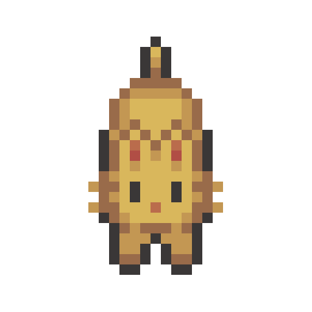</p>

# Meowmentum 喵動力

Meowmentum is a tiny pixel cat that lives on your macOS desktop and keeps your momentum going. It wanders around, follows your cursor, hops onto your windows, keeps you company while you focus, and takes a nap when you step away.

[繁體中文說明](#繁體中文)

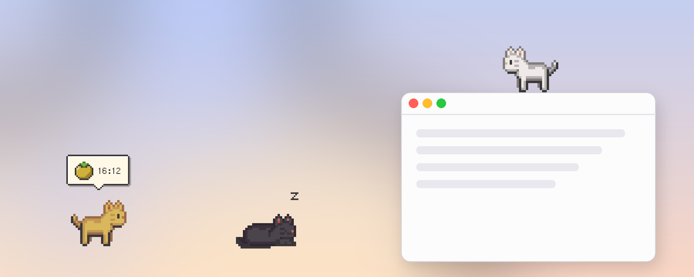

## Features

### Companion

- **Five modes.** The cat can stay put, wander, follow your cursor, walk on top of other apps' windows, or sleep.
- **Walk on windows.** The cat jumps onto window title bars and strolls along them. It rides along when you drag a window, and it falls down when the window closes.
- **Naps.** After a few idle minutes, the cat curls up and sleeps. It wakes up as soon as you come back. Choose the Sleep mode if you want the cat to keep sleeping. In Sleep mode, clicking the cat gives it a pat without waking it up.
- **Petting.** Move the cursor back and forth over the cat, and it purrs and shows hearts.
- **Treats with five flavors.** Drop a can from the top of the screen, and the cat runs over to eat it. Each flavor gets a different reaction. Tuna makes the cat happy, chicken makes it purr, salmon makes it jump for joy, catnip gives it the zoomies until it gets dizzy, and bitter melon makes it pull a face and walk away.
- **Cat house.** Send one cat or every cat home. Inside, the cats take naps or peek out of the door and windows, and smoke curls up from the chimney while anyone is home. When nobody is home, the door and windows stay closed. The windows shine like glass, and the door has a big paw print. Flower bushes by the door drift little petals now and then. The house comes in small, medium, and large, and you can drag it anywhere. Right-click the house to call the cats back out.
- **More cats.** Adopt several cats in different colors. Each one remembers its own settings.
- **Cat palette.** Design your own cat by picking any fur and eye color, with a live preview. Add a coat pattern too: tabby stripes, tuxedo, calico, or spots, each with its own pattern colors. Give each color its own name, or leave it blank and it is numbered automatically. Numbers stay in order with no gaps after you delete a color. Your colors appear in every cat's Color menu, and you can rename, edit, or delete them at any time.
- **Customizable.** Choose from four coat colors, your own colors and patterns, and three sizes. Drag the cat anywhere with the left mouse button.

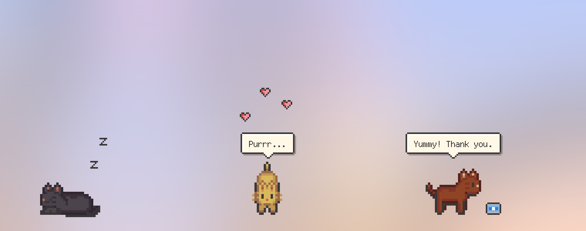

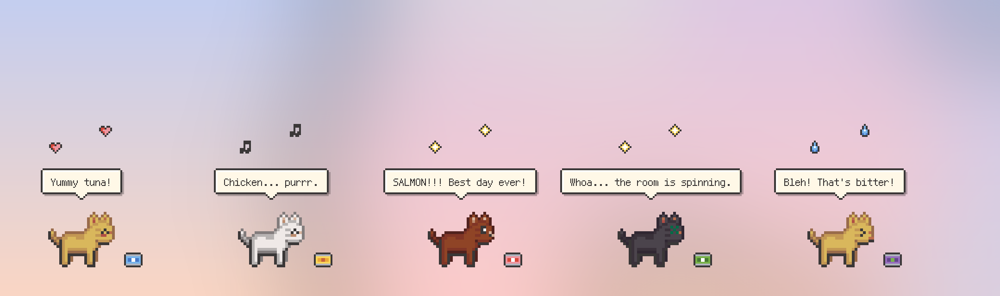

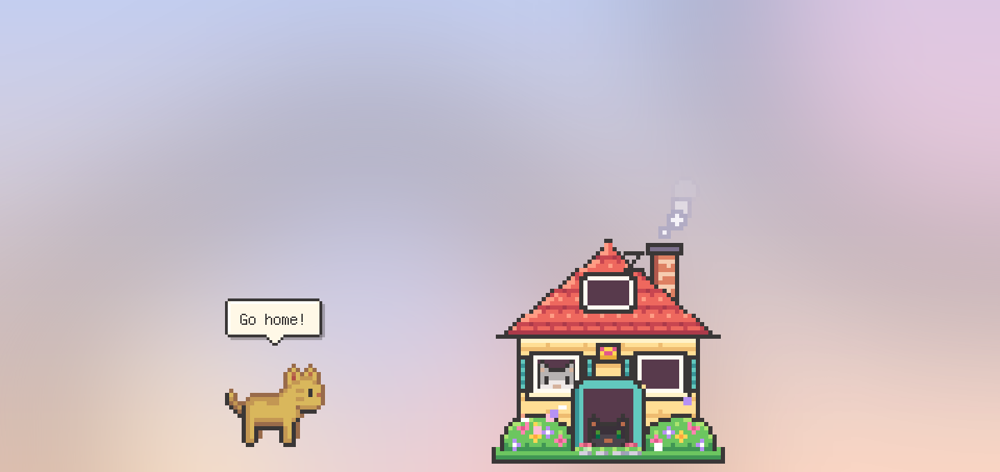

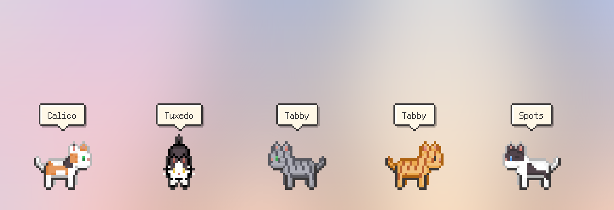

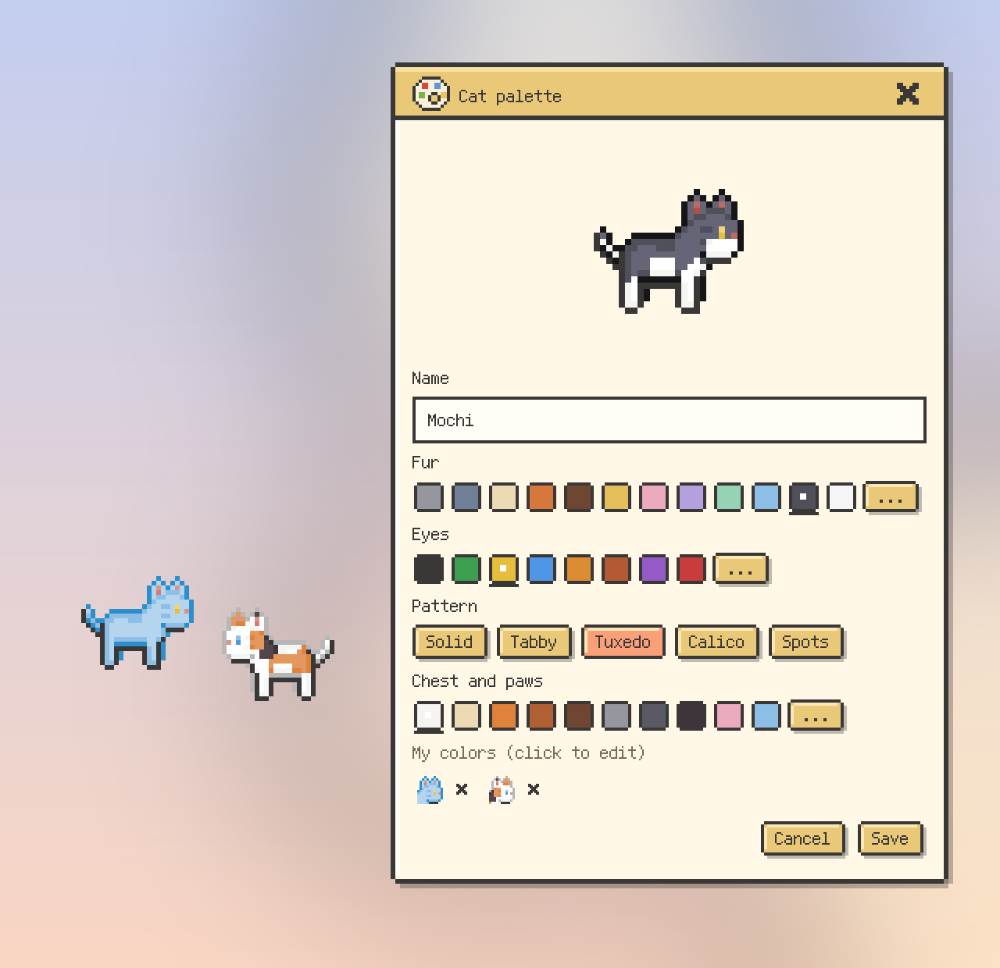

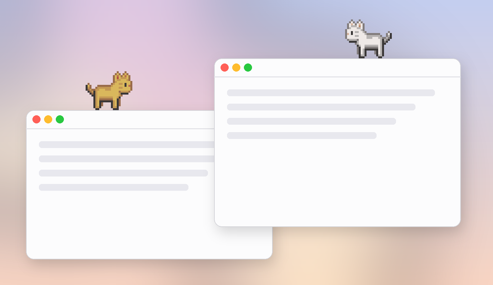

### Productivity

- **Pomodoro timer.** Focus for 15, 25, or 50 minutes, or set your own time. A pixel tomato above the cat ripens as time passes. It starts yellow-green, turns yellow-orange halfway, and becomes red when time is up. Then the cat walks to the middle of the screen to remind you, and a break starts automatically.
- **Custom focus and break times.** Pick any length from 1 to 180 minutes with the plus and minus buttons, the arrow keys, or the quick presets. Your recent custom times appear in the picker, and you can remove any of them. Your break length is used after every focus session.
- **To-do list.** Open a game-style quest log from the right-click menu or the menu bar. When every quest is checked, the cat spins with joy.
- **Break reminders.** Every 30, 45, or 60 minutes, the cat reminds you to stretch, drink water, or rest your eyes. It stays quiet while you focus or when you are away.
- **Low battery alerts.** Below 20% battery, the cat gets sleepy and asks you to charge. When you plug in, it thanks you.

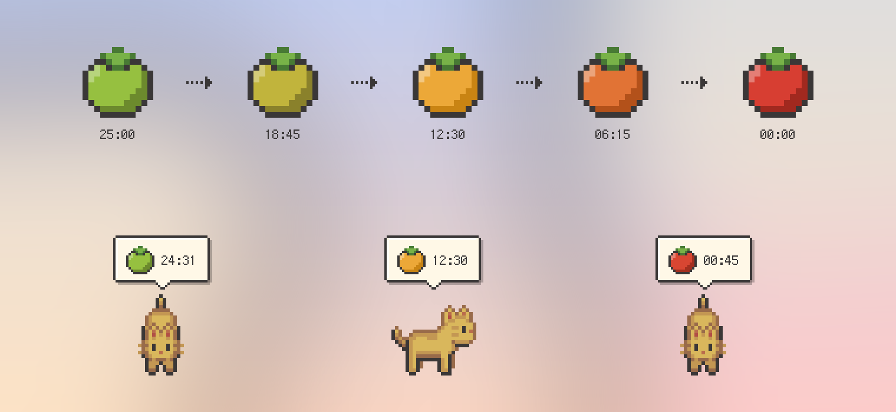

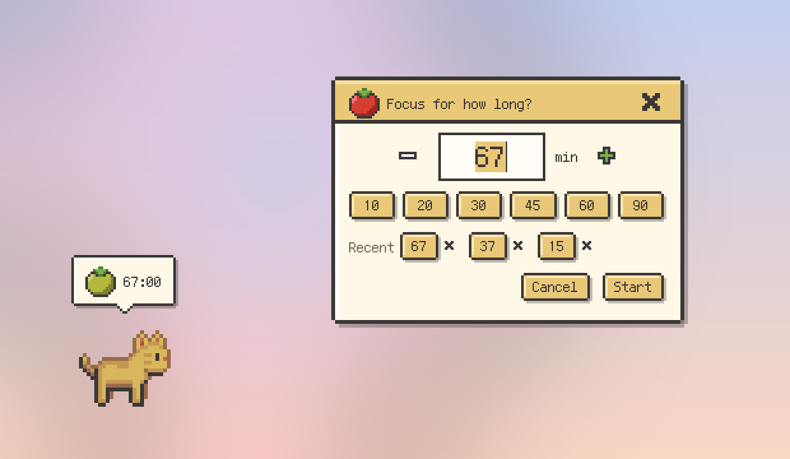

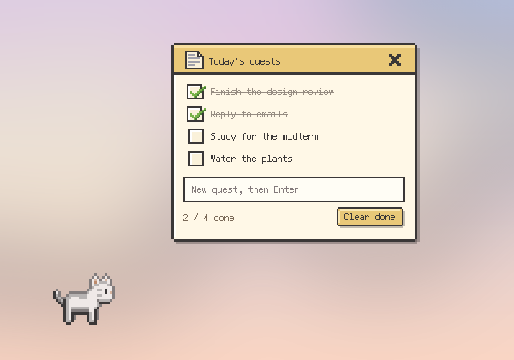

### Control every cat at once

- **Menu bar icon.** A small cat icon in the macOS menu bar controls all cats together. Change every cat's mode, feed everyone, send everyone home, start the Pomodoro timer, or open the to-do list without right-clicking each cat.

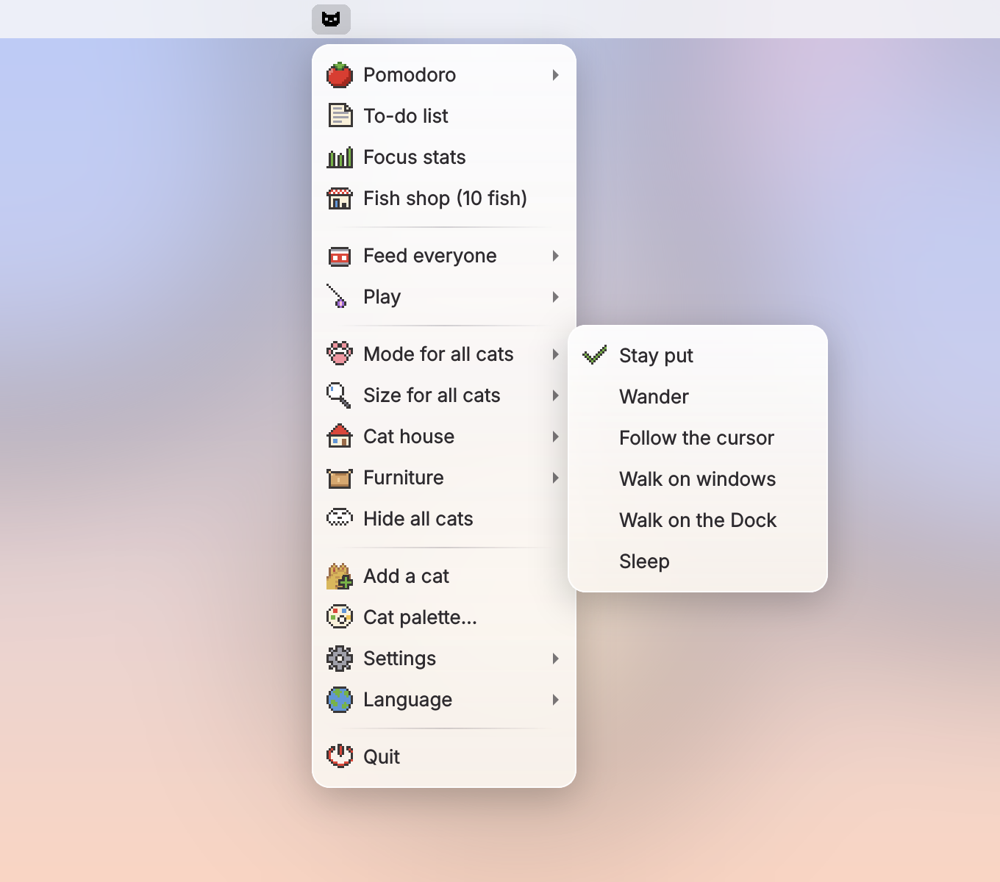

### Design

- **App icon.** Four candy-colored cats press their faces against a window.
- **Glass menu.** The right-click menu uses the native macOS frosted-glass material with a soft transparent gradient and pixel-art icons. Submenus open instantly.
- **Pixel-art dialogs.** Speech bubbles and the to-do list look like a retro game, with a pixel font that supports both English and Traditional Chinese.
- **English and Traditional Chinese.** Switch languages any time from the menu. The first launch follows your system language.

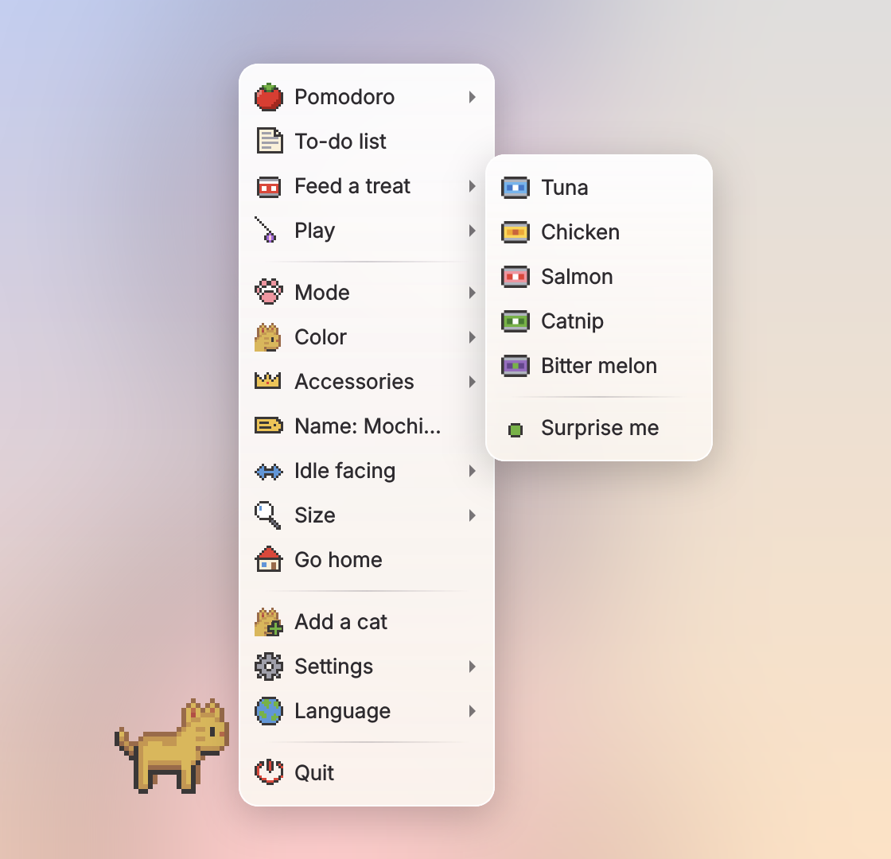

## Battery-friendly by design

| Area | How it saves power |
| --- | --- |
| Windows | Each cat is a window exactly the size of the cat, so moving it costs almost nothing. |
| Timers | Timers run only when needed. Movement is 30 fps, and cats rest between walks. |
| Background checks | One light check every 0.4 seconds detects idle time and petting. |
| Sleeping | A sleeping cat only breathes once per second. |
| Images | Sprites are cut, scaled, and cached once at startup. |
| Battery | The battery is read once every 2 minutes. |
| Cat house | Petals drift by in short bursts every few seconds, and the animation timer stops between bursts. Chimney smoke runs only while cats are home. |
| Window detection | Window positions are read only in "Walk on windows" mode. Window contents are never read, so no screen-recording permission is needed. |

## Install

You need macOS and Python 3.9 or later. If you do not have Python, run `xcode-select --install` in Terminal first.

### Option 1: Build the app (recommended)

```bash
git clone https://github.com/Tanuki3701/meowmentum.git
cd meowmentum
bash build_mac.sh
```

The app is installed to your Applications folder. After that, open it from Spotlight or Launchpad by searching for **Meowmentum**.

To start the cat automatically when you log in, open System Settings, go to General, then Login Items, and add Meowmentum.

### Option 2: Run from source

Run `bash run.command` in Terminal. The first run installs the dependencies automatically.

You can also run it manually.

```bash
python3 -m venv .venv
.venv/bin/pip install -r requirements.txt
.venv/bin/python src/main.py
```

## Usage

- **Right-click** the cat (or two-finger click on a trackpad) to open the menu for that cat.
- **Click the cat icon in the menu bar** to control all cats at once.
- Every feature is in the right-click menu. A left click just gives the cat a pat, and it wakes up a sleeping cat.
- **Drag** the cat with the left mouse button to move it.
- To quit, right-click the cat and choose **Quit**.

## Project structure

```
meowmentum/
├── src/
│   ├── main.py          # Entry point
│   ├── controller.py    # Manages all cats and global features
│   ├── cat.py           # One cat: animation, movement, jumping
│   ├── overlay.py       # Pixel speech bubble and effects above the cat
│   ├── panels.py        # Pixel to-do list, time picker, cat palette, and the falling treat
│   ├── house.py         # Cat house where the cats nap and peek out
│   ├── glassmenu.py     # Frosted-glass right-click menu
│   ├── pixel.py         # Pixel font, pixel icons, the ripening tomato, dialog frames
│   ├── i18n.py          # English and Traditional Chinese strings
│   ├── sprites.py       # Sprite loading and caching
│   └── macos.py         # macOS helpers: Dock icon, Spaces, idle time, window positions, glass
├── assets/
│   ├── sprites/         # Cat sprites (walking, sleeping, expressions, faces), effects, cat house
│   ├── fonts/           # Fusion Pixel font (SIL OFL 1.1)
│   ├── icon.png         # App icon
│   └── tray.png         # Menu bar icon
├── tools/
│   ├── make_sprites.py      # Generates sprites, expressions, the cat house, and the icons
│   └── make_screenshots.py  # Generates the screenshots in this README
├── docs/screenshots/    # README images
├── Meowmentum.spec      # PyInstaller build settings
├── build_mac.sh         # One-step build and install
└── run.command          # Run from source
```

## Credits

- The pixel font is [Fusion Pixel Font](https://fusion-pixel-font.takwolf.com) by TakWolf, licensed under the SIL Open Font License 1.1. See `assets/fonts/LICENSE-fusion-pixel.txt`.
- The sleeping sprites, expressions, cat faces, cat house, cans, and icons were drawn pixel by pixel in the style and palette of the original sprites. All coat colors, including custom ones, are applied from one shared palette, so the built-in colors match the original sprites exactly.

---

## 繁體中文

喵動力（Meowmentum）是一隻住在 macOS 桌面上的像素小貓，陪你保持前進的動力。牠會散步、跟著滑鼠、跳到視窗上走、陪你專注，你離開電腦時牠就趴著睡覺。

### 功能

#### 陪伴

- **五種模式：**待著不動、隨意漫步、跟著滑鼠、在其他 App 的視窗上走，或是睡覺。
- **在視窗上走：**貓咪會跳到視窗頂端散步。你拖動視窗時牠會跟著移動，視窗關掉時牠會掉下來。
- **睡覺：**一段時間沒碰電腦，貓咪會趴下來睡覺。你一回來牠就醒了。如果想一直看貓咪睡覺，可以選「睡覺」模式。在睡覺模式下點貓咪只會摸摸頭，不會把牠吵醒。
- **摸摸：**滑鼠在貓咪身上來回滑動，牠會呼嚕呼嚕並冒出愛心。
- **五種口味的罐罐：**天上會掉下一個罐頭，貓咪會跑過去吃。每種口味的反應都不一樣。鮪魚讓貓咪很開心，雞肉讓牠呼嚕呼嚕，鮭魚讓牠開心到跳起來，貓薄荷讓牠瘋狂衝刺到頭暈，苦瓜則會讓牠皺眉走開。
- **貓屋：**可以讓一隻或全部的貓回家。貓咪在家裡會睡覺，或從門窗探出頭來。有貓咪在家時煙囪會冒煙。沒有貓咪在家時門窗都會關起來，玻璃窗會反光，大門上還有一個大大的肉球。門口兩側的花叢偶爾會飄出小花瓣。貓屋有大、中、小三種大小，可以拖到任何地方，在貓屋上按右鍵就能叫貓咪出來。
- **多隻貓：**可以同時養好幾隻不同顏色的貓，每隻都會記住自己的設定。
- **貓咪調色盤：**可以自己挑毛色和眼睛顏色，設計專屬的貓咪，還有即時預覽。也可以加上花紋，有虎斑、賓士、三花和斑點，每種花紋的顏色都能自己選。每個毛色都可以取名字，沒取名的會自動編號，刪掉之後編號會重新接續，不會跳號。自訂的毛色會出現在每隻貓的「顏色」選單裡，隨時都能改名、修改或刪除。
- **自訂外觀：**有四種毛色、你自訂的毛色和花紋，以及三種大小，用滑鼠左鍵就能把貓咪拖到任何地方。

#### 實用

- **番茄鐘：**可以專注 15、25 或 50 分鐘，也可以自訂時間。貓咪頭上的像素番茄會隨時間變色，一開始是黃綠色，過一半變成黃橘色，時間到了變成紅色。時間到時貓咪會走到畫面中間提醒你，接著自動開始休息。
- **自訂專注與休息時間：**可以用加減按鈕、方向鍵或常用時間按鈕，選 1 到 180 分鐘。最近用過的自訂時間會顯示在選擇器裡，每一個都可以刪除。設定好的休息長度會套用在之後每次專注結束時。
- **待辦清單：**從右鍵選單或選單列打開遊戲風格的任務欄。全部打勾時，貓咪會開心轉圈。
- **休息提醒：**每 30、45 或 60 分鐘提醒你伸懶腰、喝水或讓眼睛休息。你在專注或不在電腦前時不會打擾。
- **低電量提醒：**電量低於 20% 時，貓咪會變得懶洋洋並提醒你充電。接上電源時牠會跟你道謝。

#### 一次控制全部貓咪

- **選單列圖示：**macOS 螢幕最上方的選單列會有一個小貓圖示，可以一次控制全部的貓。不用一隻一隻按右鍵，就能切換全部貓咪的模式、餵全部的貓、讓大家回家、開始番茄鐘，或打開待辦清單。

#### 設計

- **App 圖示：**四隻糖果色的貓咪把臉貼在窗戶上。
- **毛玻璃選單：**右鍵選單使用 macOS 原生的毛玻璃材質，搭配透明漸層與像素圖示，子選單會立刻展開。
- **像素風對話框：**對話泡泡和待辦清單都是復古遊戲風格，像素字型同時支援英文和繁體中文。
- **中英文切換：**隨時可以在選單裡切換語言。第一次開啟時會依照系統語言自動選擇。

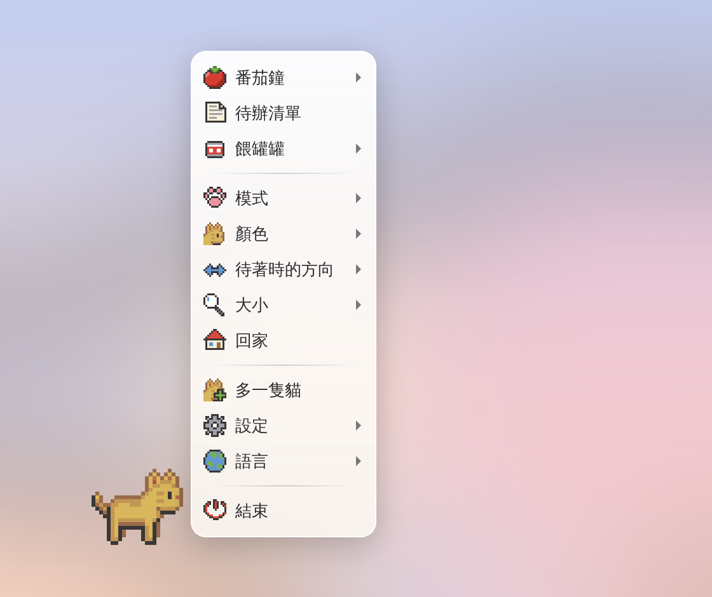

### 安裝

需要 macOS 與 Python 3.9 以上的版本。如果還沒有 Python，請先在終端機執行 `xcode-select --install`。

```bash
git clone https://github.com/Tanuki3701/meowmentum.git
cd meowmentum
bash build_mac.sh
```

完成後 App 會安裝到「應用程式」資料夾。之後用 Spotlight 或 Launchpad 搜尋 **Meowmentum** 就能開啟。

如果想讓貓咪在開機時自動出現，請到「系統設定」的「一般」裡的「登入項目」，把 Meowmentum 加進去。

### 使用方式

- 在貓咪身上**按右鍵**（觸控板雙指點按）可以打開那隻貓的選單。
- **點選單列上的小貓圖示**可以一次控制全部的貓。
- 所有功能都在右鍵選單裡。用左鍵點貓咪只會摸摸頭，點睡著的貓咪會把牠叫醒。
- 用滑鼠左鍵**拖曳**可以移動貓咪。
- 要結束程式時，在貓咪身上按右鍵並選擇**結束**。

### 致謝

- 像素字型使用 TakWolf 的 [Fusion Pixel Font](https://fusion-pixel-font.takwolf.com)，授權為 SIL Open Font License 1.1，授權全文在 `assets/fonts/LICENSE-fusion-pixel.txt`。
- 睡姿、表情、正面貓臉、貓屋、罐頭和圖示都是依照原始精靈圖的畫風和調色盤一格一格畫出來的。所有毛色（包含自訂毛色）都從同一套調色盤上色，所以內建毛色和原圖完全一致。
