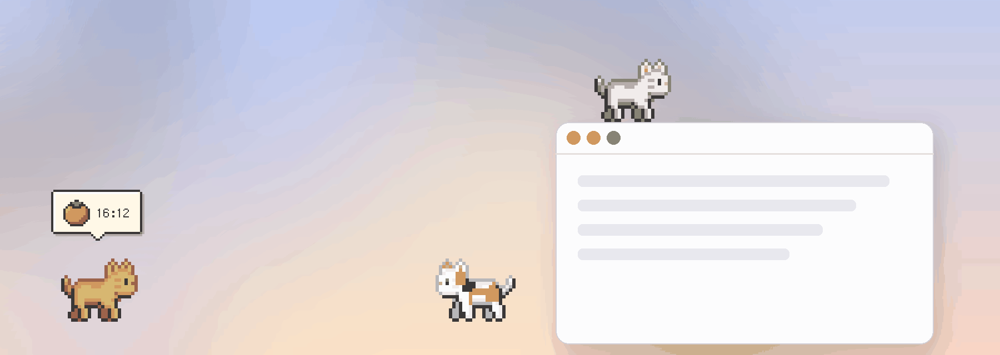
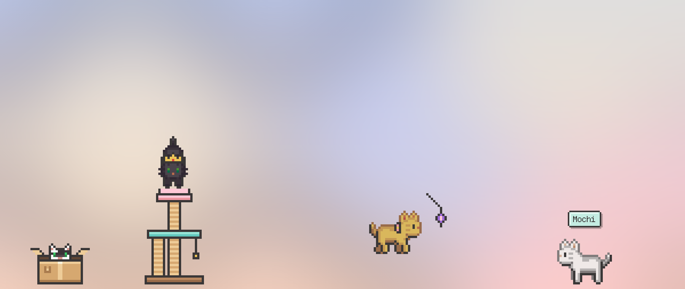
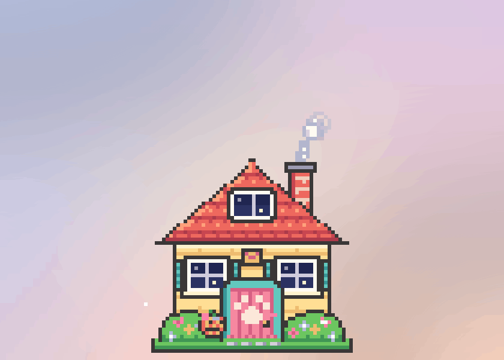
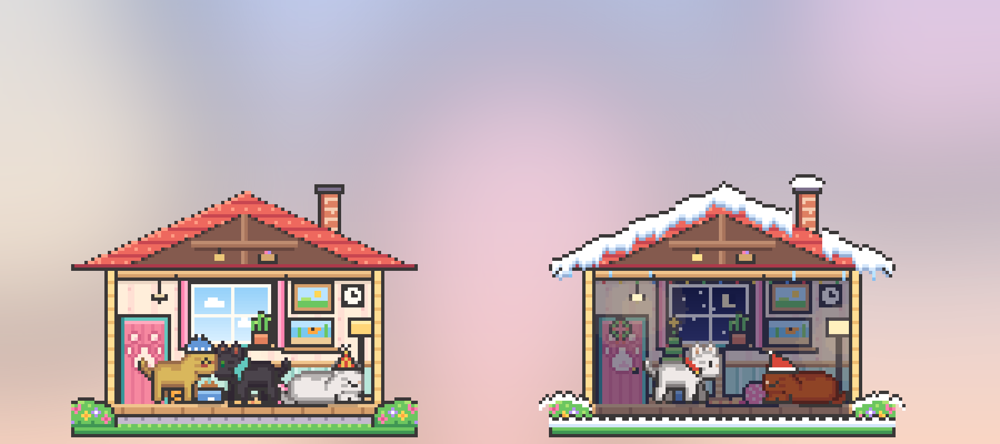
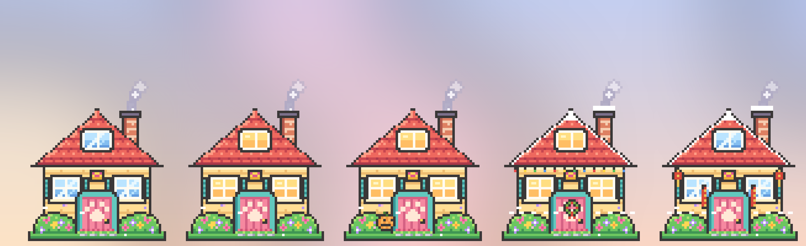
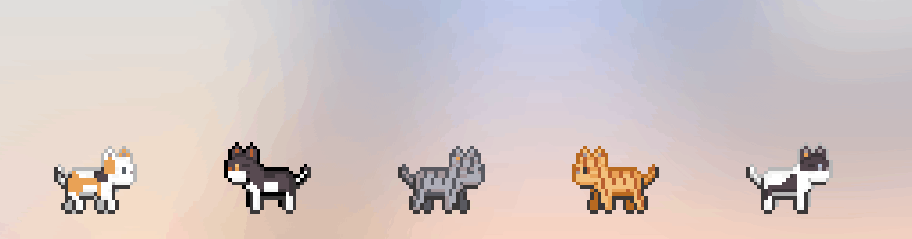
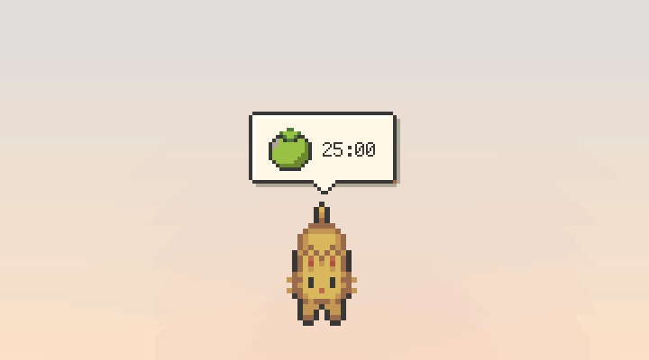
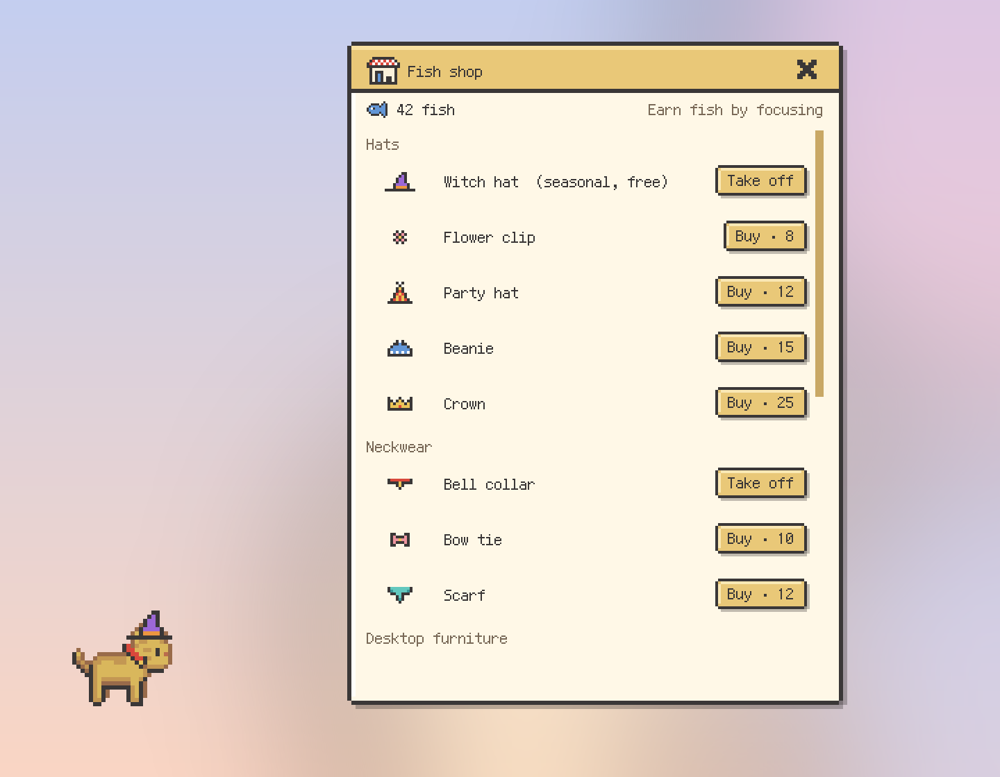
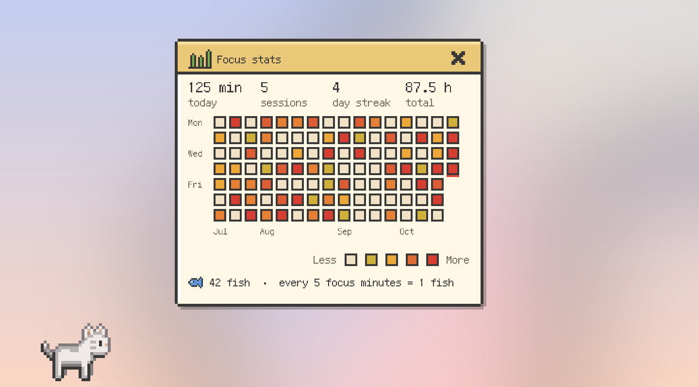

<p align="center"></p>

# Meowmentum 喵動力

Meowmentum is a tiny pixel cat that lives on your macOS desktop and keeps your momentum going. It wanders around, follows your cursor, hops onto your windows, keeps you company while you focus, and takes a nap when you step away.

[繁體中文說明](#繁體中文)


## Features

### Companion

- **Six modes.** The cat can stay put, wander, follow your cursor, walk on top of other apps' windows, stroll along the Dock, or sleep.
- **Walk on windows.** The cat jumps onto window title bars and strolls along them. It rides along when you drag a window, and it falls down when the window closes.
- **Naps.** After a few idle minutes, the cat curls up and sleeps. It wakes up as soon as you come back. Choose the Sleep mode if you want the cat to keep sleeping. In Sleep mode, clicking the cat gives it a pat without waking it up.
- **Petting.** Move the cursor back and forth over the cat, and it purrs and shows hearts. Poke it five times in a row, and it gets grumpy and walks away.
- **Treats with five flavors.** Drop a can from the top of the screen, and the cat runs over to eat it. Each flavor gets a different reaction. Tuna makes the cat happy, chicken makes it purr, salmon makes it jump for joy, catnip gives it the zoomies until it gets dizzy, and bitter melon makes it pull a face and walk away.
- **Toys.** Take out a feather wand or a yarn ball, and every cat chases it and pounces.
- **Cats play together.** With two or more cats, they chase each other, sniff each other, and groom each other. When it is time to nap, they squeeze together and sleep side by side.
- **Names.** Give each cat a name. Hover over a cat to see its name tag.
- **A little gift.** If you are away for more than 20 minutes, your cat leaves a small gift next to it. Click the gift to collect it.






### Cat house

- **Home sweet home.** Send one cat or every cat home. Inside, the cats take naps or peek out of the door and windows. Smoke always curls up from the chimney, and flower bushes by the door drift little petals now and then. When nobody is home, the door and windows stay closed. The house comes in small, medium, and large, and you can drag it anywhere.
- **Look inside.** Double-click the house to look inside. The cats at home sleep on the cushion, eat from the bowl, walk around, and play. The room changes with the time of day, and the furniture you buy appears in the room.
- **Day and night.** In the evening, the windows light up with warm lamps. Late at night, your cat yawns and reminds you to go to bed.
- **Seasons and holidays.** The house decorates itself by the date. You will see pumpkins for Halloween, a wreath and lights for Christmas, snow in winter, spring couplets and lanterns for Lunar New Year, and cherry petals in spring. You can turn this off in Settings.







### Your cats, your style

- **Cat palette.** Design your own cat by picking any fur and eye color, with a live preview. Add a coat pattern too: tabby stripes, tuxedo, calico, or spots, each with its own pattern colors. Give each color its own name, or leave it blank and it is numbered automatically. Numbers stay in order with no gaps after you delete a color.
- **Accessories.** Dress your cats in a party hat, a crown, a beanie, a flower clip, a bell collar, a bow tie, or a scarf. A witch hat is free around Halloween, and a Santa hat is free in December.
- **Desktop furniture.** Put a cardboard box or a cat tree on your desktop. Cats wander over by themselves. In the box, only their head peeks out. On the cat tree, they sit on the top platform.
- **More cats.** Adopt several cats. Each one remembers its own color, accessories, name, and settings.




### Productivity

- **Pomodoro timer.** Focus for 15, 25, or 50 minutes, or set your own time. A pixel tomato above the cat ripens as time passes. It starts yellow-green, turns yellow-orange halfway, and becomes red when time is up. Then the cat walks to the middle of the screen to remind you, and a break starts automatically.
- **Earn fish by focusing.** Every finished focus session earns dried fish, one for every 5 minutes. Spend them in the fish shop on accessories and furniture.
- **Focus stats.** See today's focus time, your streak, and your total hours, with a pixel calendar of the last 16 weeks.
- **Quiet focus.** Turn on "Cats go home while I focus" in Settings. The other cats go home to nap, and one cat stays to show the countdown. They come back out for your break.
- **Custom focus and break times.** Pick any length from 1 to 180 minutes with the plus and minus buttons, the arrow keys, or the quick presets. Your recent custom times appear in the picker, and you can remove any of them.
- **To-do list.** Open a game-style quest log from the right-click menu or the menu bar. When every quest is checked, the cat spins with joy.
- **Break reminders.** Every 30, 45, or 60 minutes, the cat reminds you to stretch, drink water, or rest your eyes. It stays quiet while you focus or when you are away.
- **Low battery alerts.** Below 20% battery, the cat gets sleepy and asks you to charge. When you plug in, it thanks you.









### Works well with macOS

- **Menu bar icon.** A small cat icon in the macOS menu bar controls all cats together. Change every cat's mode or size, feed everyone, play with everyone, send everyone home, open the shop and stats, or start the Pomodoro timer.
- **Hide all cats.** Press Control-Option-M anywhere to hide every cat, for example before a meeting or screen sharing. Press it again to bring them back. The cats also hide by themselves while an app is in full screen.
- **Open at login.** Turn it on in Settings, and the cats are there every time you start your Mac.
- **Low Power Mode.** When Low Power Mode is on, the cats move with fewer frames to save even more battery.
- **Multiple displays.** Wandering cats sometimes walk over to your other screen.
- **Update check.** Once a day, Meowmentum checks GitHub for a new version and tells you when one is out. You can turn this off in Settings.


### Design

- **App icon.** Four candy-colored cats press their faces against a window.
- **Glass menu.** The right-click menu uses the native macOS frosted-glass material with a soft transparent gradient and pixel-art icons. Submenus open instantly.
- **Pixel-art dialogs.** Speech bubbles, the to-do list, the shop, and the stats look like a retro game, with a pixel font that supports both English and Traditional Chinese.
- **English and Traditional Chinese.** Switch languages any time from the menu. The first launch follows your system language.


## Battery-friendly by design

| Area | How it saves power |
| --- | --- |
| Windows | Each cat is a window exactly the size of the cat, so moving it costs almost nothing. |
| Timers | Timers run only when needed. Movement is 30 fps, and cats rest between walks. |
| Background checks | One light check every 0.4 seconds detects idle time and petting. |
| Sleeping | A sleeping cat only breathes once per second. |
| Images | Sprites are cut, scaled, and cached once at startup. |
| Battery | The battery is read once every 2 minutes. |
| Cat house | The house animates only its own small window, with coalesced timers. When the house is hidden, it runs no timers at all. The room inside animates only while you are looking at it. |
| Toys and furniture | A toy follows the cursor only while it is out, and it is put away after 90 seconds. Furniture runs no timers. Cats check for furniture and friends only every 14 to 25 seconds. |
| Low Power Mode | In Low Power Mode, cats redraw at half the frame rate. |
| Dock mode | The Dock size is read from the Dock settings at most once every 20 seconds, and only in "Walk on the Dock" mode. |
| Window detection | Window positions are read only in "Walk on windows" mode. Window contents are never read, so no screen-recording permission is needed. |

## Install

### Option 1: Download the app (easiest)

1. Open the [latest release](https://github.com/Tanuki3701/meowmentum/releases/latest).
2. Download `Meowmentum-apple-silicon.zip` for M-series Macs, or `Meowmentum-intel.zip` for Intel Macs. To check, open the Apple menu and choose About This Mac.
3. Unzip it and drag **Meowmentum** into your Applications folder.
4. Open it once. Because the app is not signed with a paid Apple developer account, macOS stops it the first time. Open System Settings, go to Privacy & Security, scroll down, and click **Open Anyway**. You only need to do this once.

You need macOS 11 Big Sur or later. No Python is needed.

### Option 2: Build the app yourself

Building it on your own Mac avoids the security warning.

You need macOS 11 Big Sur or later, plus Python 3.9 or later and Git. If you do not have them, run `xcode-select --install` in Terminal. It installs both. The first build needs an internet connection to download the dependencies.

Open Terminal and run these three lines. The first build takes a few minutes.

```bash
git clone https://github.com/Tanuki3701/meowmentum.git
cd meowmentum
bash build_mac.sh
```

If you downloaded the ZIP from GitHub instead, unzip it, then run `bash build_mac.sh` from that folder in Terminal. Run it with `bash` rather than double-clicking, because macOS blocks double-clicked scripts that came from the internet.

The app is installed to your Applications folder. No administrator password is needed. If the Applications folder is not writable, the app goes to `~/Applications` instead.

### Option 3: Run from source

Run `bash run.command` in Terminal. The first run installs the dependencies automatically.

You can also run it manually.

```bash
python3 -m venv .venv
.venv/bin/pip install -r requirements.txt
.venv/bin/python src/main.py
```

### Open at login

Right-click a cat, open Settings, and choose **Open at login**.

## Usage

- **Right-click** the cat (or two-finger click on a trackpad) to open the menu for that cat.
- **Click the cat icon in the menu bar** to control all cats at once.
- **Double-click the cat house** to look inside.
- Press **Control-Option-M** to hide or show all cats.
- Every feature is in the right-click menu. A left click just gives the cat a pat, and it wakes up a sleeping cat.
- **Drag** the cat with the left mouse button to move it.
- To quit, right-click the cat and choose **Quit**.

## Project structure

```
meowmentum/
├── src/
│   ├── main.py          # Entry point
│   ├── controller.py    # Manages all cats and global features
│   ├── cat.py           # One cat: animation, movement, jumping
│   ├── overlay.py       # Pixel speech bubble and effects above the cat
│   ├── panels.py        # Pixel to-do list, time picker, cat palette, and the falling treat
│   ├── house.py         # Cat house where the cats nap and peek out
│   ├── interior.py      # The room inside the cat house
│   ├── toys.py          # Toys, desktop furniture, and gifts
│   ├── social.py        # Cats playing together and napping side by side
│   ├── shop.py          # Fish shop, focus stats, and the name window
│   ├── progress.py      # Fish, focus history, and items
│   ├── seasons.py       # Day, night, and holiday decorations
│   ├── art.py           # Pixel art for accessories, toys, furniture, and decorations
│   ├── updater.py       # Daily update check
│   ├── glassmenu.py     # Frosted-glass right-click menu
│   ├── pixel.py         # Pixel font, pixel icons, the ripening tomato, dialog frames
│   ├── i18n.py          # English and Traditional Chinese strings
│   ├── sprites.py       # Sprite loading and caching
│   ├── version.py       # Version number
│   └── macos.py         # macOS helpers: Spaces, idle time, windows, glass, shortcut, login item
├── assets/
│   ├── sprites/         # Cat sprites (walking, sleeping, expressions, faces), effects, cat house
│   ├── fonts/           # Fusion Pixel font (SIL OFL 1.1)
│   ├── icon.png         # App icon
│   └── tray.png         # Menu bar icon
├── tools/
│   ├── make_sprites.py      # Generates sprites, expressions, the cat house, and the icons
│   └── make_screenshots.py  # Generates the screenshots in this README
├── docs/screenshots/    # README images
├── .github/workflows/   # Builds the downloadable apps for each release
├── Meowmentum.spec      # PyInstaller build settings
├── build_mac.sh         # One-step build and install
└── run.command          # Run from source
```

## Credits

- The pixel font is [Fusion Pixel Font](https://fusion-pixel-font.takwolf.com) by TakWolf, licensed under the SIL Open Font License 1.1. See `assets/fonts/LICENSE-fusion-pixel.txt`.
- The sleeping sprites, expressions, cat faces, cat house, room, accessories, toys, furniture, cans, and icons were drawn pixel by pixel in the style and palette of the original sprites. All coat colors, including custom ones, are applied from one shared palette, so the built-in colors match the original sprites exactly.

---

## 繁體中文

喵動力 (Meowmentum) 是一隻住在 macOS 桌面上的像素小貓，陪你保持前進的動力。牠會散步、跟著滑鼠、跳到視窗上走、陪你專注，你離開電腦時牠就趴著睡覺。

### 功能

#### 陪伴

- **六種模式**：待著不動、隨意漫步、跟著滑鼠、在其他 App 的視窗上走、在 Dock 上散步，或是睡覺。
- **在視窗上走**：貓咪會跳到視窗頂端散步。你拖動視窗時牠會跟著移動，視窗關掉時牠會掉下來。
- **睡覺**：一段時間沒碰電腦，貓咪會趴下來睡覺，你一回來牠就醒了。想一直看貓咪睡覺的話可以選「睡覺」模式，這時點貓咪只會摸摸頭，不會把牠吵醒。
- **摸摸**：滑鼠在貓咪身上來回滑動，牠會呼嚕呼嚕並冒出愛心。連續戳牠五下，牠會不耐煩地走開。
- **五種口味的罐罐**：天上會掉下一個罐頭，貓咪會跑過去吃，每種口味的反應都不一樣。鮪魚讓貓咪很開心，雞肉讓牠呼嚕呼嚕，鮭魚讓牠開心到跳起來。貓薄荷會讓牠瘋狂衝刺到頭暈，苦瓜則會讓牠皺眉走開。
- **逗貓玩具**：拿出逗貓棒或毛線球，所有貓咪都會追過去撲。
- **貓咪之間會互動**：養兩隻以上的貓時，牠們會互相追著跑、聞聞對方、幫對方理毛。要睡覺時還會擠在一起睡。
- **取名字**：可以幫每隻貓取名字，滑鼠移到貓咪身上就會看到牠的名牌。
- **小禮物**：離開電腦超過 20 分鐘，回來時貓咪旁邊會多一個小禮物，點一下就能收下。


#### 貓屋

- **回家**：可以讓一隻或全部的貓回家。貓咪在家裡會睡覺，或從門窗探出頭來。煙囪一直都會冒著淡淡的煙，門口兩側的花叢偶爾會飄出小花瓣。沒有貓咪在家時門窗都會關起來。貓屋有大、中、小三種大小，可以拖到任何地方。
- **進去看看**：在貓屋上按兩下就能看到屋子裡面。在家的貓咪會睡在軟墊上、吃飯、散步和玩耍。房間會跟著白天晚上變化，你在商店買的擺設也會出現在房間裡。
- **白天和晚上**：傍晚以後貓屋的窗戶會亮起暖暖的燈。深夜時貓咪會打哈欠，提醒你早點睡。
- **節慶裝飾**：貓屋會依照日期自動換裝飾。萬聖節有南瓜，聖誕節有花圈和燈泡，冬天屋頂會積雪，農曆新年會貼春聯、掛燈籠，春天會飄粉紅色的花瓣。不想要的話可以在設定裡關掉。


#### 打扮你的貓

- **貓咪調色盤**：可以自己挑毛色和眼睛顏色，設計專屬的貓咪，還有即時預覽。也可以加上虎斑、賓士、三花或斑點的花紋，每種花紋的顏色都能自己選。每個毛色都可以取名字，沒取名的會自動編號，刪掉之後編號會重新接續，不會跳號。
- **飾品**：可以幫貓咪戴上派對帽、皇冠、毛線帽、小花髮夾、鈴鐺項圈、領結或圍巾。萬聖節前後可以免費戴巫師帽，十二月可以免費戴聖誕帽。
- **桌面家具**：可以在桌面上放紙箱或貓跳台，貓咪會自己走過去。鑽進紙箱時只會露出頭，在貓跳台上會坐在最上層。
- **多隻貓**：可以同時養好幾隻貓，每隻都會記住自己的毛色、飾品、名字和設定。


#### 實用

- **番茄鐘**：可以專注 15、25 或 50 分鐘，也可以自訂時間。貓咪頭上的像素番茄會隨時間變色，一開始是黃綠色，過一半變成黃橘色，時間到了變成紅色。時間到時貓咪會走到畫面中間提醒你，接著自動開始休息。
- **專注換小魚乾**：每完成一次專注就能得到小魚乾，每 5 分鐘 1 條。可以在小魚乾商店換飾品和家具。
- **專注紀錄**：可以看到今天專注了多久、連續幾天，以及總共專注幾小時，還有最近 16 週的像素日曆。
- **安靜專注**：在設定裡打開「專注時貓咪回家」後，其他貓咪會回家睡覺，只留一隻顯示倒數，休息時間再一起出來陪你。
- **自訂專注與休息時間**：可以用加減按鈕、方向鍵或常用時間按鈕選 1 到 180 分鐘。最近用過的自訂時間會顯示在選擇器裡，每一個都可以刪除。
- **待辦清單**：從右鍵選單或選單列打開遊戲風格的任務欄。全部打勾時，貓咪會開心轉圈。
- **休息提醒**：每 30、45 或 60 分鐘提醒你伸懶腰、喝水或讓眼睛休息。你在專注或不在電腦前時不會打擾。
- **低電量提醒**：電量低於 20% 時，貓咪會變得懶洋洋並提醒你充電。接上電源時牠會跟你道謝。


#### 和 macOS 好好相處

- **選單列圖示**：螢幕最上方的選單列有一個小貓圖示，可以一次控制全部的貓。可以切換全部貓咪的模式和大小、餵全部的貓、陪大家玩、讓大家回家、打開商店和紀錄，或開始番茄鐘。
- **一鍵藏起所有貓**：在任何地方按 Control-Option-M 就能把所有貓藏起來，開會或分享螢幕前很方便，再按一次就會回來。App 進入全螢幕時，貓咪也會自動藏起來。
- **開機自動打開**：在設定裡打開後，每次開機貓咪都會出現。
- **低耗電模式**：Mac 開啟低耗電模式時，貓咪的動畫會放慢，更省電。
- **多螢幕**：隨意漫步的貓咪偶爾會走到另一個螢幕。
- **檢查更新**：每天會到 GitHub 檢查一次有沒有新版本，有的話貓咪會告訴你。不需要的話可以在設定裡關掉。

#### 設計

- **App 圖示**：四隻糖果色的貓咪把臉貼在窗戶上。
- **毛玻璃選單**：右鍵選單使用 macOS 原生的毛玻璃材質，搭配透明漸層與像素圖示，子選單會立刻展開。
- **像素風對話框**：對話泡泡、待辦清單、商店和紀錄都是復古遊戲風格，像素字型同時支援英文和繁體中文。
- **中英文切換**：隨時可以在選單裡切換語言。第一次開啟時會依照系統語言自動選擇。


### 安裝

#### 方法一：直接下載 App (最簡單)

1. 打開[最新版本](https://github.com/Tanuki3701/meowmentum/releases/latest)的頁面。
2. M 系列晶片的 Mac 請下載 `Meowmentum-apple-silicon.zip`，Intel 的 Mac 請下載 `Meowmentum-intel.zip`。不確定的話，可以在蘋果選單的「關於這台 Mac」查看。
3. 解壓縮後，把 **Meowmentum** 拖到「應用程式」資料夾。
4. 打開一次。因為這個 App 沒有用付費的 Apple 開發者帳號簽署，第一次打開時 macOS 會擋下來。請到「系統設定」的「隱私權與安全性」，往下捲動後按「**強制打開**」。只需要做一次。

需要 macOS 11 Big Sur 以上，不需要安裝 Python。

#### 方法二：自己打包

在自己的 Mac 上打包就不會跳出安全性警告。

需要 macOS 11 Big Sur 以上，以及 Python 3.9 以上和 Git。如果還沒有，請在終端機執行 `xcode-select --install`，兩個都會一起裝好。第一次打包需要網路來下載套件。

打開終端機，執行下面三行。第一次打包需要幾分鐘。

```bash
git clone https://github.com/Tanuki3701/meowmentum.git
cd meowmentum
bash build_mac.sh
```

如果你是從 GitHub 下載 ZIP，請先解壓縮，再在終端機進到那個資料夾執行 `bash build_mac.sh`。請用 `bash` 執行，不要直接雙擊，因為 macOS 會擋下從網路下載、直接雙擊開啟的腳本。

完成後 App 會安裝到「應用程式」資料夾，不需要管理者密碼。如果「應用程式」資料夾不能寫入，App 會改裝到 `~/Applications`。

#### 開機自動打開

在貓咪身上按右鍵，打開「設定」，選「**開機時自動打開**」。

### 使用方式

- 在貓咪身上**按右鍵** (觸控板雙指點按) 可以打開那隻貓的選單。
- **點選單列上的小貓圖示**可以一次控制全部的貓。
- 在**貓屋上按兩下**可以進去看看。
- 按 **Control-Option-M** 可以藏起或叫回所有貓咪。
- 所有功能都在右鍵選單裡。用左鍵點貓咪只會摸摸頭，點睡著的貓咪會把牠叫醒。
- 用滑鼠左鍵**拖曳**可以移動貓咪。
- 要結束程式時，在貓咪身上按右鍵並選擇**結束**。

### 致謝

- 像素字型使用 TakWolf 的 [Fusion Pixel Font](https://fusion-pixel-font.takwolf.com)，授權為 SIL Open Font License 1.1，授權全文在 `assets/fonts/LICENSE-fusion-pixel.txt`。
- 睡姿、表情、正面貓臉、貓屋、房間、飾品、玩具、家具、罐頭和圖示都是依照原始精靈圖的畫風和調色盤一格一格畫出來的。所有毛色 (包含自訂毛色) 都從同一套調色盤上色，所以內建毛色和原圖完全一致。
